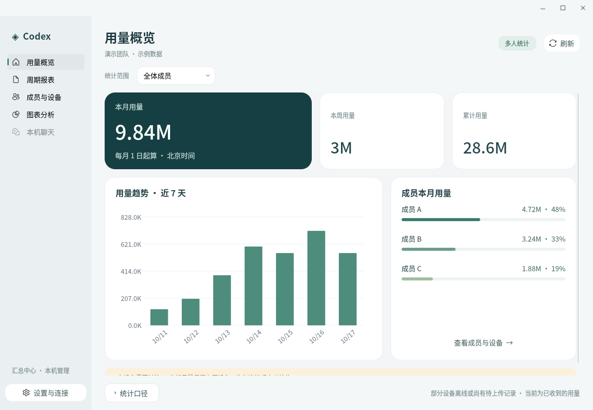
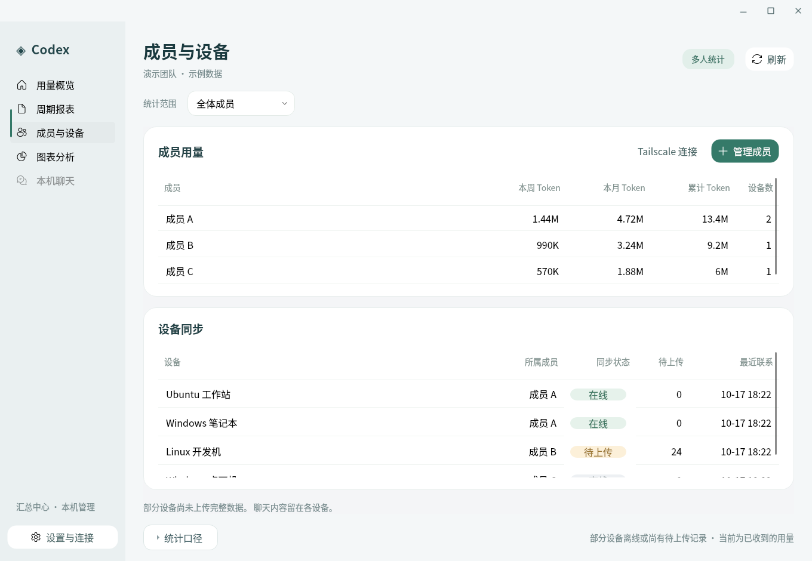
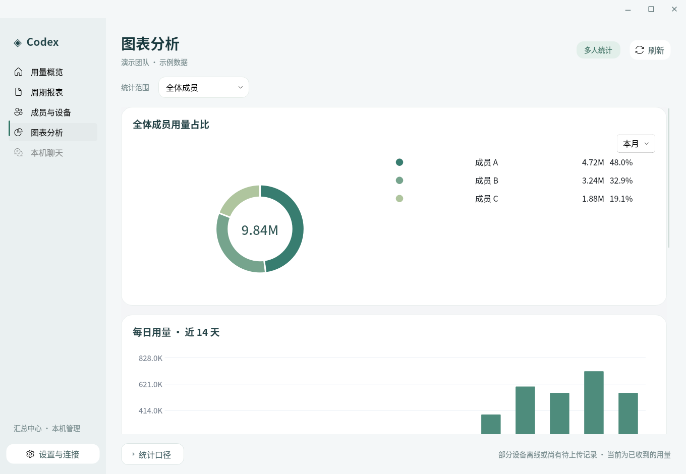
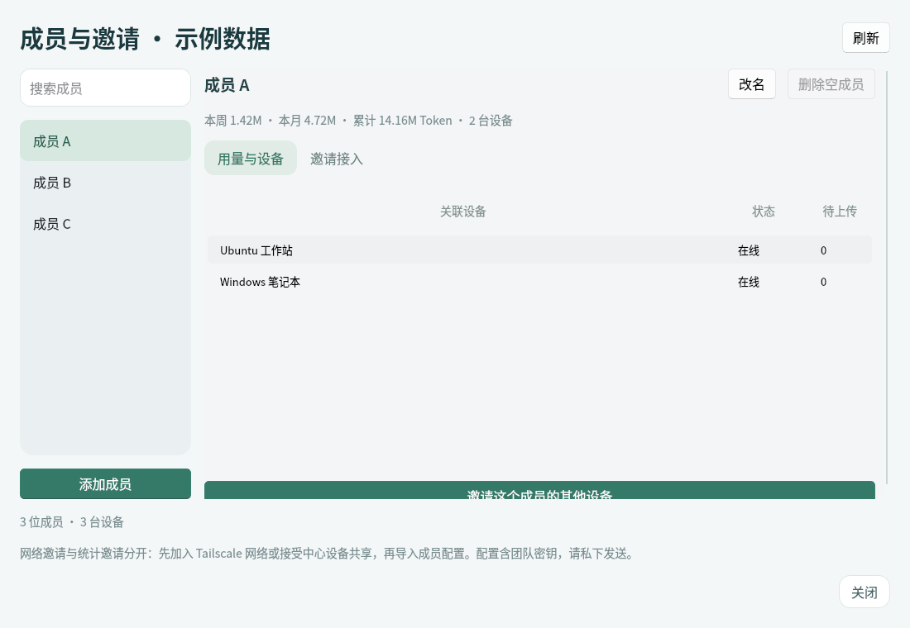
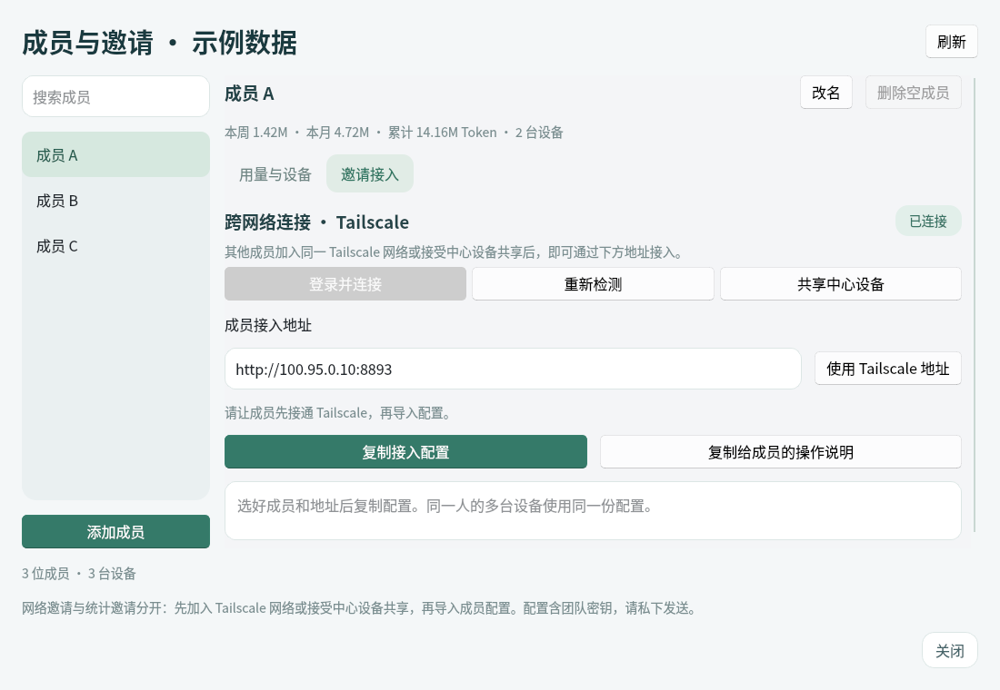

# Codex 用量统计

为多人共用同一个 OpenAI 账号提供的原生桌面用量工具。每台电脑只采集自己的 Codex GUI / CLI 日志，再将计量事件上传到一个汇总中心，按成员和全体生成周报、月报。

界面使用 **Qt Widgets + QFluentWidgets + Qt Charts** 在本地绘制，保留较大的字体、圆角卡片和本地图表，无需浏览器或 WebView。后台通过本机 HTTP 接口与原生界面通信；界面不使用网页渲染。

- 本 fork：<https://github.com/Serenade-Intermezzo/AI-usage-tracker>
- 原始项目：<https://github.com/Danielw412/AI-usage-tracker>
- 原生多人版：**0.3.0**。

## 能做什么

| 功能 | 行为 |
| --- | --- |
| 成员与设备 | 搜索、添加和改名，查看个人用量与设备；可删除未关联设备的空成员，已有归属和历史保留 |
| Tailscale 接入 | 原生检测安装 / 登录 / 连接状态，辅助安装和授权，自动取得中心地址，测试成员配置与中心连接 |
| 个人及全员报表 | 原生界面可切换本机、全体成员或指定成员，查看累计、本周、本月以及历史周月报 |
| 月度周期 | 汇总中心统一设置每月 1–31 日起算，采集设备自动同步，不能各自修改 |
| 跨设备同步 | 持久化待上传队列，断网保留、恢复补传；按稳定事件标识去重 |
| 图表 | 全体成员用量占比饼图（本周 / 本月 / 累计）；日用量、活跃热力图和模型构成跟随统计范围 |
| 同步状态 | 查看成员的设备数、设备在线状态、待上传数量和最近联系时间 |
| 账号范围 | 仅采集绑定 OpenAI 账号的官方 Codex GUI / CLI 可确认事件，汇总中心校验账号指纹 |
| 数据范围 | 不启用 Claude Code、不查询账号全局用量，不默认上传聊天正文、标题或项目路径 |

“本机聊天”入口始终保留在侧栏，仅在顶部“统计范围”选择“本机”时可用。选择“全体成员”或某位成员时，入口会变灰；团队视图只展示计量信息。

## 界面预览

以下截图为原生窗口，使用示例数据，不包含任何成员的真实用量或接入密钥。







<details>
<summary>成员管理与 Tailscale 接入预览（示例数据）</summary>





</details>

侧栏将概览、周期报表、成员设备、图表和本机聊天分成独立页面。概览展示本月、本周、累计用量、最近趋势和成员占比；需要补传或离线的设备会直接提示。统计范围在所有页面共用，可随时切换全体或指定成员。

图表分析页的环形饼图始终比较全体成员，可切换本月、本周和累计，图例显示每人的 Token 和占比。下方保留原生日用量、热力图和模型图表。页面删除重复说明小标题。

右上角提供最小化、最大化 / 还原、关闭三个按钮。最大化填满当前屏幕的可用桌面区域；**F11** 切换覆盖整块屏幕的全屏，**Esc** 退出全屏并恢复进入前的普通或最大化状态。双击顶部空白区域可最大化 / 还原。小屏幕或高缩放比例下，内容在页面内滚动，不再撑大窗口。

### “本机聊天”为什么是灰色的？

这个入口跟随顶部的“统计范围”：

| 当前统计范围 | “本机聊天”入口 |
| --- | --- |
| 本机 | 可用，显示这台电脑上的 Codex 聊天标题、入口、模型和 Token 用量 |
| 全体成员 | 灰色，不可点击 |
| 某位成员（包括自己） | 灰色，不可点击；成员报表可能汇总多台设备 |

要查看当前电脑的聊天，请先将顶部“统计范围”切换为 **本机**，再点击侧栏 **本机聊天**。该列表只包含符合绑定账号与采集范围的本机记录。

团队同步只上传计量事件，聊天正文、标题和项目路径保留在各自电脑上。因此，选择团队或成员范围时，没有可供查看的跨设备聊天明细；入口变灰表示当前范围不支持该页面。

导航与页面组织参考 [PyQt-Fluent-Widgets](https://github.com/zhiyiYo/PyQt-Fluent-Widgets) 的原生导航组件和 [Microsoft WinUI Gallery](https://github.com/microsoft/WinUI-Gallery) 的信息层次，使用现有 Qt 工具独立实现，未引入网页渲染或额外 GUI 框架。

## 多人使用流程

选择一台经常开机的电脑作为汇总中心，其他电脑作为采集设备。汇总中心也可以同时采集本机用量；不采集本机时可作为独立服务器。

### 1. 在汇总中心建立团队

1. 安装程序并在 Codex 中登录要统计的 OpenAI 账号。
2. 打开左下角的 **设置与连接**，工作方式选择 **作为汇总中心**。
3. 填写本机使用者的姓名 / 昵称和设备名称。
4. 需要其他电脑连接时，勾选 **允许其他设备连接此汇总中心**。默认只监听本机。
5. 保存并等待后台自动重启。
6. 打开 **成员与设备 → 管理成员**，为每位使用者添加成员。

同一账号不等于同一成员。成员身份由这里的登记和设备关联确定，无法从共用的 OpenAI 登录信息自动识别实际使用者。

### 2. 先接通不同网络的电脑（Tailscale）

成员不在同一个局域网时，使用 Tailscale 连接。局域网 IP（例如 `192.168.x.x`、`10.x.x.x`）通常不能从其他网络直接访问，勾选“允许其他设备连接”也不会自动建立跨网络通道。

1. 在中心打开 **成员与设备 → Tailscale 连接**，或在 **设置与连接** 中打开同名入口。
2. 点击 **安装 Tailscale**。Linux 通过系统授权对话框调用官方安装脚本；Windows 通过 winget 安装官方包，没有相应安装工具时打开官方下载页。安装需要联网和系统管理员授权。
3. 点击 **登录并连接**，在官方浏览器页面完成授权。界面会区分尚未安装、等待登录、尚未连接、等待管理员批准和已连接。
4. 其他成员也安装并连接 Tailscale。各自使用自己的 Tailscale 身份，加入同一个获准的网络，或接受中心设备的共享邀请。**Tailscale 身份与共用的 OpenAI 账号无关，不要分享登录密码。**
5. 中心点击 **邀请加入网络**，进入官方设备管理页，选中中心设备进行共享；成员接受共享后才具有网络连接条件。这份网络邀请需要单独发送，统计工具的成员配置不能代替它。
6. 回到统计工具 **成员与设备 → 管理成员 → 邀请接入**。程序会自动填写已连接的本机 Tailscale IPv4 地址，也可点击 **使用 Tailscale 地址** 重新填入，例如 `http://100.x.y.z:8893`。

中心仍须保持运行并允许其他设备连接；防火墙与 Tailscale 的访问规则须允许成员访问中心的 TCP 端口（默认 `8893`）。通过设备共享接入时，以成员在 Tailscale 中看到、可访问的中心地址为准，必要时在生成该成员配置前调整地址。程序不配置出口节点、子网路由、Funnel 或公网端口转发，也不会重置已有的 Tailscale 自定义设置。

安装和登录使用官方客户端及系统授权，程序不保存 Tailscale 密码、授权密钥或浏览器登录链接。Tailscale 组网本身不是统计账号验证，统计上传仍校验团队密钥、成员、设备与 OpenAI 账号指纹。

参考：[Tailscale 安装](https://tailscale.com/docs/install)、[连接设备](https://tailscale.com/docs/how-to/connect-to-devices)、[共享设备](https://tailscale.com/docs/features/sharing)。

### 3. 为每个人生成接入配置

在成员管理中添加或搜索一个成员，选中后进入 **邀请接入**，优先使用自动检测到的 Tailscale 地址。也可以手动填写其他设备确实可访问的中心地址，例如同一局域网中的：

```text
http://192.168.1.10:8893
```

点击 **复制接入配置**，或点击 **复制给成员的操作说明**，把步骤与配置一起发送。这份配置包含该成员编号、目标账号指纹、中心地址和团队访问密钥。**只私下发送给对应成员，不要放进公开仓库、截图或日志。**

同一人的多台电脑使用同一份成员接入配置；每台电脑会保留独立设备编号。不要在不同电脑之间复制整个数据目录或 `device.json`。

局域网中需允许该端口通过汇总端防火墙。跨公网使用 HTTPS 或可信 VPN；程序本身不配置 TLS、路由器端口转发或公网服务器。

### 4. 在各台设备接入

1. 在该设备自己的 Codex GUI / CLI 中，通过同一个 OpenAI 账号登录。
2. 安装并打开原生界面，进入 **设置与连接 → 加入汇总中心**。
3. 确保 Tailscale 已连接并取得中心访问权限；粘贴这个人的接入配置（也支持粘贴整段操作说明），填写设备名称。
4. 点击 **测试中心连接**，确认中心、成员和账号范围后，保存并等待后台重启。
5. 顶部范围菜单可选择 **本机 / 全体成员 / 某位成员**。
6. 在“成员与设备”检查设备是否已联系中心、是否还有待上传记录。

设备首次登记后，成员编号与安装实例保持固定，避免重复设备编号或更换成员时悄悄改写历史归属。需要修改人的显示名称，请在汇总中心使用“修改姓名”；历史会保留在原成员编号下。暂不提供已有设备历史的跨成员转移功能。

成员管理左侧可搜索成员，右侧分为“用量与设备”和“邀请接入”。添加后会选中新成员；改名保留成员编号和全部设备归属。不允许重复姓名（忽略首尾空格和大小写），可以使用不同昵称区分。只有未关联设备且不是中心当前使用者的成员可删除；中心再次校验后才会删除，旧邀请随之无法接入。已有设备的成员不能删除，以免破坏历史。

### 5. 统一设置月度起始日

在**汇总中心本机**的原生界面中进入“周期报表”，选择“每月起始日”，点击保存。

- 所有人使用同一个起始日，采集设备的日期控件只读。
- 修改后重新计算历史月报；周报不受影响。
- 采集设备通过心跳取得最新设置，即使没有打开团队报表也会更新。
- 中心离线时，本机月报沿用最后收到的日期，恢复连接后更新。
- 选择 29、30 或 31 日而当月没有该日期时，使用当月最后一天。

所有报表统一使用 **Asia/Shanghai（北京时间，UTC+8）**，不随设备系统时区变化。周报按周一 00:00 至下周一 00:00，月报按配置日期的 00:00 分界。

后台每分钟保存一次报表快照，跨周、跨月后自动标记已结束；关机后再次启动会补算。离线事件到达后，历史周期也会更新，避免把“周期已结束”误认为“所有设备都已完整上传”。

## 统计范围与覆盖限制

### 账号范围

统计来自本机日志，不读取共享账号的全局用量接口。采集端只接受官方 OpenAI provider 和 Codex GUI / CLI 入口，包括可确认的子代理调用。

- 首次运行将目标账号的非密钥标识做 SHA256，保存为本机账号绑定。
- 带明确账号标识的历史日志，仅在账号匹配时纳入。
- 不带账号标识的事件，仅在后台实际观察到该账号登录的时段纳入。
- 后台停止期间的无账号标记历史不推定归属；其他账号、第三方 API 和不符合入口范围的记录排除。
- 汇总中心固定目标账号指纹，拒绝范围不一致的上传。

账号指纹用于范围一致性校验，不是密码或访问令牌。成员身份仍以设备登记为准；该工具不能从共享账号中辨认谁实际操作了键盘，也不提供对采集端日志的第三方计费认证。

如果旧版数据库尚未建立账号绑定，首次启用范围筛选时会将旧数据库保存到数据目录的 `unscoped-backup-*`，再从符合条件的日志重建；不把旧的未筛选缓存直接上传。

### Token 口径

- 总 Token 使用日志记录的 `total_tokens`，输入已包含缓存输入，避免重复加算。
- 聊天数按周期内不同线程计数；模型图基于相同范围的事件。
- 重试和完整历史重传不会重复计数。同一份日志复制到不同设备时，相同事件只计一次，归属首次收到该事件的设备。
- 这不是 OpenAI 官方账单，也不代表未安装本工具、未接入团队或未上传设备的用量。

有设备离线、尚有待上传记录、首次扫描未完成时，界面会提示当前只显示已收到的用量。周期结束后仍可能继续补传。未知或尚未关联成员的历史事件会单独提示，不默认为某个人。

### 访问权限与隐私

- 团队密钥用于设备上传和团队计量报表读取；团队成员可以查看个人及全体统计。
- 成员管理、接入配置生成和月度设置修改仅在中心本机原生界面进行。
- 远程接口不提供本机聊天明细、个人配置或登录文件。
- 同步仅发送 Token 事件、稳定标识、模型、时间及必要删除记录；正文、聊天标题、项目路径和额度样本不上传。
- 密钥保存在设备自己的 `installation.json`，默认按用户私有权限写入；Windows 还依赖用户资料目录的 ACL。
- 不修改 Codex 登录状态，也不复制 `auth.json` 到源码、发布包或团队中心。

## 安装

需要 Node.js **22.5+**、Python **3.10+**。建议使用当前 Node 22 LTS 与 Python 3.11；GUI 依赖见 `gui/requirements.txt`。

### Windows 10 / 11 x64

1. 安装 Node.js 和 Python，确保可以从终端启动。
2. 在本机 Codex GUI / CLI 中通过目标 OpenAI 账号登录。
3. 下载或 clone 本 fork，完整解压到固定目录。
4. 双击 `scripts\install-native-windows.cmd`，等待依赖安装与后台构建完成。
5. 使用桌面的 **Codex Usage Tracker** 快捷方式打开界面。

首次安装需联网。安装器会创建 GUI 快捷方式和登录时启动后台的快捷方式；关闭窗口不停止后台采集。移动源码目录后需重新安装快捷方式。

数据保存在：

```text
%LOCALAPPDATA%\CodexUsageTracker\data-current-account
```

要关闭登录后启动，可在 `shell:startup` 中删除“Codex Usage Background”。这是源码安装方式，不是独立 EXE。

### Ubuntu / 其他桌面 Linux

Ubuntu 示例；其他 Linux 发行版使用对应包管理器准备 Python venv 和 Qt 所需桌面库。

```bash
git clone https://github.com/Serenade-Intermezzo/AI-usage-tracker.git
cd AI-usage-tracker
cp .env.example .env
npm ci --ignore-scripts --no-audit --no-fund
npm run build:native
python3 -m venv .venv-gui
.venv-gui/bin/python -m pip install -r gui/requirements.txt
bash scripts/install-linux-service.sh
bash scripts/open-local-gui.sh
```

需要先安装 Node.js 22.5+；Ubuntu 若缺少 venv / Qt 桌面库，可安装 `python3-venv libxcb-xinerama0 libxcb-cursor0 libegl1`。后台运行在当前用户的 systemd 服务中，不需要管理员账户读取其他人的会话。

默认数据目录为源码目录下的 `data/`；可在 `.env` 中配置 `DATA_DIR`。程序自动发现当前用户的 `.codex-desktop` 和 `.codex`，也可通过 `CODEX_HOME` / `CODEX_EXTRA_HOMES` 指定。后者的分隔符在 Linux 为冒号、Windows 为分号。

```bash
systemctl --user status ai-usage-tracker
systemctl --user restart ai-usage-tracker
systemctl --user disable --now ai-usage-tracker
```

### 无本机采集的中心

可在设置中选择“作为汇总中心”，关闭“同时采集这台电脑的 Codex 用量”，填入目标账号指纹。此时中心不需要 OpenAI 登录文件。首次部署也可通过 `.env` 设置 `TRACKER_ROLE=server`、`CODEX_SCAN=false`、`TEAM_ACCOUNT_FINGERPRINT` 和 `SYNC_SECRET`。

纯服务器无需启动 GUI，但需要通过中心本机的管理接口登记成员并获取接入配置；建议首次在有桌面的中心完成设置。管理请求需要来自回环地址且带 `X-Tracker-Local: 1`。不对公网开放管理 API。

## 数据和更新

```text
server/installation.ts    安装角色、连接配置的校验和持久化
server/team.ts            成员、设备绑定、团队周月报和图表数据
server/sync/              上传、去重、持久队列、重试与心跳
server/codex/accountScope.ts  本机账号范围筛选
server/localReports.ts    本机周期报表及共享的日期聚合逻辑
gui/main.py              启动入口、后台启动及统一字体主题
gui/window.py            数据请求、范围切换和交互控制
gui/ui.py                侧栏、概览卡片、报表和成员设备页面
gui/titlebar.py          窗口按钮、原生边缘调整与全屏快捷键
gui/utils.py             共享路径和显示格式
gui/team.py              原生团队设置、成员搜索 / 设备详情和邀请流程
gui/tailscale.py         异步网络检测、安装授权、地址识别与原生接入引导
gui/connection.py        邀请解析和账号范围校验的异步中心连接测试
gui/charts.py            本地 Qt 图表
```

数据目录包含：

```text
codex-usage.sqlite        本机 / 中心计量数据；采集设备还包含待上传队列
device.json               独立设备和安装实例标识
account-scope.json        非密钥账号指纹、观察到的登录时间范围
installation.json         角色、成员、连接地址和私有团队密钥
team.sqlite               中心的成员与设备归属
sync.sqlite               中心的设备心跳与上传状态
report-settings.json      本机或中心月度起始日
team-calendar.json        采集设备最后收到的中心日期设置及时间
local-reports.json        本机报表快照
team-reports.json         中心全员与每位成员的周月报快照
```

更新源码时保留整个数据目录和 `.env`，然后重新安装依赖、构建并重启后台。不要把私有数据、密钥、登录文件、会话日志或虚拟环境提交到公共仓库。保存数据目录时应使用数据库在线备份，或先停止后台后整体复制。

本机既有安装的源码目录：`$HOME/.local/share/ai-usage-tracker`；既有账号筛选数据使用其 `data-current-account/`。其他安装以自己的 `.env` / Windows 用户资料目录为准。

## 仓库范围

当前只维护原生 Codex 统计。旧 React / Vite / Recharts 网页端、Claude 采集器、账号额度预测、云任务、浏览器演示页及相关依赖已移除。后台运行依赖仅保留 Express 和 dotenv。原生图表、日志增量扫描、账号筛选、多人同步和周月报保留。

数据库旧结构和迁移路径保留，用于安全升级现有安装；没有通过清空历史来精简代码。构建时先清理旧产物，生产输出不包含测试和已经删除的旧模块。

## 测试与验证范围

```bash
npm run typecheck
npm run build:native
npm test
QT_QPA_PLATFORM=offscreen .venv-gui/bin/python -m unittest discover -s gui/tests -v
```

测试覆盖账号范围、北京时间周月边界、短月份、多成员和多设备归属、事件重传去重、统一月度设置、真实 server / collector 进程启动、扫描上传、账号及 Claude 拒绝、离线队列与重启补传、网络访问权限、旧缓存迁移，以及原生范围切换和界面交互。

清理后保留 40 项后台测试，覆盖现有 Codex 与多人功能；另有 30 项原生界面 / 环境测试，包含成员饼图与周期切换，以及最大化、全屏、还原的实际几何尺寸断言。新增测试还覆盖 Tailscale 状态、超时、授权链接、Windows 客户端查找、邀请解析、禁止本机回环地址、中心认证 / 账号 / 成员校验、不跟随重定向、搜索和邀请失效，以及删除成员的历史保护。旧网页、Claude 和账号额度等已删除功能对应的测试随之移除。

本机 Ubuntu X11 桌面另行运行原生交互测试，检查最大化窗口与可用桌面矩形一致、全屏窗口与整个屏幕矩形一致；仅检查窗口状态标志不足以确认铺满屏幕。

GitHub Actions 的 `.github/workflows/native-gui.yml` 在 Ubuntu 和 Windows 上运行后台与 GUI 测试，并在 Windows 检查安装脚本。CI 结果以仓库 Actions 中相应提交为准；自动化检查不等于在每位成员的真实电脑上完成账号登录、网络连接和完整日常使用验收。

Tailscale 自动化测试使用合成状态与独立进程 / HTTP 服务，不会登录真实网络。跨网络真实接入仍需要中心和至少一台成员设备完成官方授权、设备共享或网络成员批准，再确认上传成功。
